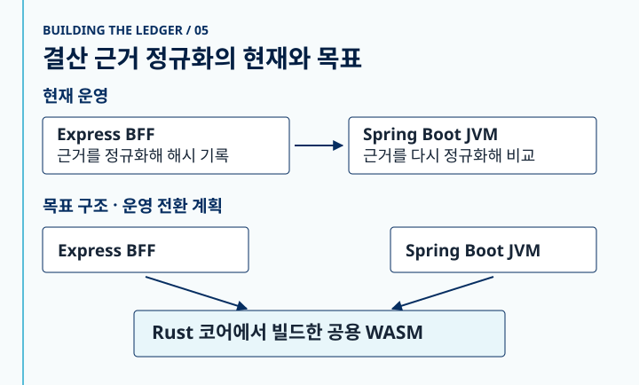
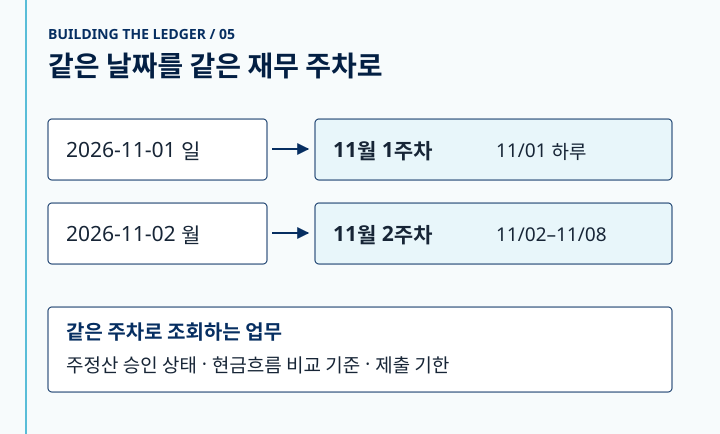

안녕하세요. MYSCube를 만들고 있는 MYSC AXR팀입니다.

Express BFF와 Spring Boot 서버가 같은 결산 근거를 읽습니다. BFF는 요청을 만들면서 해시를 기록하고, Spring Boot는 확정 직전에 해시를 다시 계산해요. 두 곳 모두 SHA-256을 쓰는데도 테스트에서 서로 다른 값이 나왔습니다. 각 서버가 해시를 계산하기 전에 JSON을 자기 방식으로 문자열로 만들고 있었기 때문입니다.

한쪽 구현을 다른 쪽과 맞추면 이 테스트는 통과합니다. 그런데 다음에 규칙이 바뀌면 또 두 곳을 함께 고쳐야 해요. 저희가 Rust 리팩토링에서 바꾸려는 것은 이 지점입니다. **업무 명령과 트랜잭션은 기존 서버가 처리하고, 같은 입력에 같은 답을 내야 하는 규칙은 두 서버가 하나의 구현을 공유하도록 합니다.**

## 서버의 책임을 나눈 뒤에, 규칙의 경계를 다시 그렸습니다

「Building the Ledger」 첫 글에서는 구글 시트의 숫자를 원본, 계산 결과, 승인된 기록으로 구분했습니다. 두 번째 글에서는 시트를 읽는 Express BFF와 값을 검증하는 Spring Boot 서버를 나눴어요. 그 덕분에 어느 서버에서 기록을 확인하고 상태를 바꿀지 정할 수 있었습니다. 다만 서버의 책임을 나눴다고 해서 두 서버가 필요로 하는 규칙까지 저절로 한곳에 모이지는 않았어요.

예를 들어 사용자가 버전 7을 보고 승인 요청을 보냈는데 그사이 기록이 버전 8로 바뀌었다면, 서버는 현재 저장된 버전과 상태를 확인해야 합니다. 이 사례는 버전 확인이 적용되는 주정산 명령의 합성 예시입니다. 월결산 조직장 승인을 비롯한 각 명령에는 해당 명령의 승인 조건이 적용됩니다. 어느 기록을 읽고 어떤 명령을 받아들일지 판단하는 일은 기존 서비스 경계 안에 남습니다.

반면 같은 근거 JSON을 같은 문자열로 바꾸는 함수는 승인자나 저장소에 접근할 필요가 없습니다. 기존 Rust 스프레드시트 계산 코어로 옮기기에 적합한 경계였어요. Rust 함수의 입력과 출력을 고정하면 기존 서버를 그대로 둔 채 새 구현만 대조할 수 있습니다. 이번 작업의 범위도 여러 곳에서 직접 구현하는 규칙부터 줄이는 것으로 잡았습니다.

## 첫 추출 대상은 해시 함수 앞에 있었습니다

해시 두 개가 다르다는 사실만으로는 어디서 값이 갈렸는지 알 수 없습니다. 그래서 결산 근거 해시의 대조 단위를 SHA-256에 들어가기 직전의 JSON 문자열로 잡았습니다.

공유 대조표를 만들 때 실제 BFF와 Java 구현을 돌려 보니 다섯 가지 입력에서 이미 결과가 갈렸습니다. 아래는 그중 키 정렬을 보여주는 테스트용 예시입니다.

```text
입력       {"10":"ten","9":"nine","01":"leading zero","a":"text"}
BFF        {"9":"nine","10":"ten","01":"leading zero","a":"text"}
기존 JVM   {"01":"leading zero","10":"ten","9":"nine","a":"text"}
```

자바스크립트는 객체를 JSON으로 내보낼 때 배열 인덱스처럼 생긴 키를 숫자 순서로 앞에 배치합니다. 그래서 `"9"`가 `"10"`보다 먼저 나와요. 앞에 0이 붙은 `"01"`은 이 규칙의 적용을 받지 않습니다. 다른 네 경우는 제어문자를 이스케이프할 때 쓰는 16진수 대소문자, 아주 작은 수의 지수 표기, 큰 수의 표기, 자바스크립트가 정확히 표현할 수 있는 정수 범위를 넘는 값에서 나왔습니다. 이 입력들은 차이를 재현하기 위해 만든 테스트 데이터입니다. 이 다섯 경우가 실제 결산을 막았다는 운영 기록은 확인하지 못했습니다.

숫자에서는 출력 형식만 맞춰서는 부족했어요. 예를 들어 JSON의 긴 소수를 읽을 때 파서가 서로 인접한 두 부동소수점 값 중 다른 쪽을 고르면, 출력 형식이 같아도 마지막 자릿수가 달라질 수 있습니다. PR에서 무작위 숫자 20만 개를 비교하는 과정에 `serde_json` 기본 설정이 일부 17자리 소수를 한 ULP, 즉 그 지점에서 표현할 수 있는 인접 값 한 칸만큼 다르게 읽는 경우가 나왔습니다. 그래서 코어에서 `float_roundtrip` 옵션을 켰고, 출력 쪽도 자바스크립트의 숫자 표기를 따르도록 맞췄습니다. 정산 커널의 기존 TypeScript 대조도 다시 실행했습니다.

기준은 결산 요청에 해시를 먼저 써 온 BFF입니다. 일반 사례 10건과 기존 JVM이 다른 값을 낸 5건을 표에 넣었어요. Rust는 SHA-256에 들어갈 JSON 문자열까지 책임집니다. 해시 계산은 각 호스트의 표준 구현을 사용하도록 경계를 뒀습니다. BFF 테스트는 문자열과 최종 해시를 모두 비교해요.

그리고 테스트가 정말 차이를 잡는지도 확인했습니다. 대조표 복사본에서 키 순서 사례의 기대 문자열 한 줄을 일부러 틀리게 만든 뒤 Rust 테스트를 돌렸더니, 그 사례가 실패하면서 기대한 문자열과 실제 문자열이 함께 나왔어요. 원래 값을 돌려놓으면 다시 통과합니다. 해시 두 개를 보고 원인을 추측하는 대신, 승인 전에 달라지는 바이트가 어디에서 생겼는지 확인할 수 있습니다.

## 같은 Rust 함수를 두 런타임에서 호출하는 방법

MYSCube에는 이미 Rust 스프레드시트 계산 코어가 있었습니다. 날짜에서 주차를 구하거나 JSON 값을 정규화하는 일은 데이터베이스를 읽거나 승인 권한을 검사하지 않고도 실행할 수 있어요. 이런 계산을 기존 코어에 모으고, Firestore 트랜잭션과 승인 상태 전이는 현재 그 일을 맡는 서버에 두기로 했습니다.

공유하는 방법도 몇 가지 살펴봤습니다. **날짜만 받는 규칙**이라면 Rust로 주차표를 생성해서 JVM이 읽게 할 수 있어요. 재무 담당자가 바뀐 날짜를 표에서 바로 확인할 수 있고 Java 런타임 의존성도 생기지 않습니다. 대신 표의 지원 범위를 관리해야 하고, 입력 구조가 다양한 결산 JSON이나 수식 검사에는 같은 방법을 쓰기 어렵습니다.

별도 서비스로 빼면 Node와 JVM이 같은 HTTP API를 호출할 수 있습니다. 다만 승인 트랜잭션 안에서 규칙을 실행할 때 네트워크 왕복이 늘고, 배포하고 장애를 살펴야 할 서비스도 하나 더 생깁니다. 네이티브 라이브러리는 네트워크 없이 호출할 수 있지만 운영체제와 아키텍처별 바이너리, JVM의 네이티브 경계를 함께 관리해야 해요.

현재 설계는 **같은 WASM 파일을 두 호스트에서 실행하는 것**입니다. Node는 내장 WebAssembly를 쓰고 JVM 쪽은 순수 Java 런타임인 Chicory를 후보로 두고 있어요. 재무 주차 시범에서는 연·월·일을 정수로 넘기고, WASM 메모리의 11개 정수에서 결과를 읽습니다. 예를 들어 `(2026, 11, 1)`을 넣으면 11월 1주차, 시작과 끝은 모두 11월 1일, 평일 수는 0이라는 결과가 나옵니다. 날짜 계산 코드는 Rust 코어에 있고, WASM 쪽은 호출을 받고 결과를 전달합니다. 결산 JSON처럼 구조가 있는 입력을 받는 공용 인터페이스와 JVM 패키징은 이후 단계입니다.



*그림 1. 로컬 JVM→Rust 회로도를 바탕으로 정리한 현재 결산 흐름과 목표 구조.*

## 재무 주차로 검증한 사본 제거

결산 해시가 두 구현의 차이를 보여준 사례라면, 재무 주차는 사본을 실제로 줄이는 작업이었습니다. 예를 들어 2026년 11월 1일 일요일은 재무 달력에서 1주차이고, 2일 월요일부터는 2주차입니다. 두 경로가 다른 주를 선택하면 주정산 승인 상태나 현금흐름 비교 기준도 달라질 수 있습니다.

어디서 같은 계산을 하는지 업무 이름을 따라가며 확인했습니다. 주정산 이력에서 ‘이번 주’를 찾는 코드, 예측과 실적을 비교할 기준 주를 고르는 코드, 제출 기한과 주의 시작일을 구하는 코드가 각각 날짜를 어떻게 처리하는지 봤어요. 데이터 이관 스크립트와 테스트 도구에도 같은 종류의 식이 있었습니다.

이관 스크립트에는 아래처럼 날짜의 일자를 7로 나눠 올리는 계산이 있었습니다. 오른쪽은 설명을 위해 호출을 단순화한 예시입니다.

```js
// 이전 이관 스크립트의 계산
Math.ceil(2 / 7)                           // 1

// 공통 재무 주차 함수의 결과
resolveFinanceWeekForDate("2026-11-02")
  .financeWeek                             // 2
```

2023년부터 2099년까지 두 식을 대조했더니 28,124일 중 11,100일에서 주차가 달랐습니다. **이 숫자는 두 알고리즘을 달력 전체에서 돌려본 결과**예요. 실제로 틀린 거래나 승인 건수를 센 값은 아닙니다. 스크립트는 공통 TypeScript 함수를 부르도록 바꿨고, 변경된 주 코드는 다음번에 스테이징 데이터를 생성할 때부터 적용됩니다.

JVM에서는 재무 주차의 구간 계산을 공통 함수로 모았습니다. 이때 함수를 옮기는 것과 호출부의 동작을 보존하는 일이 따로 있었습니다. 예를 들어 시간값을 받아 비교 기준 주를 구하는 경로는 지원 연도 범위를 검사했어요. 정리하는 과정에서 그 검사가 빠졌을 때 기존 경계 테스트가 2022년 12월 31일 입력에서 차이를 잡았습니다. 공통 함수로 바꾸면서 그 호출부의 범위 검사는 유지했어요.

이 작업에서 사본으로 센 것은 **날짜에서 주차를 구하거나, 주차에서 날짜 구간을 직접 계산하는 코드**입니다. 공통 함수를 호출하는 곳은 세지 않았습니다.

| 계산하는 곳 | 전 | 후 | 바꾼 내용 |
| --- | ---: | ---: | --- |
| TypeScript 공통 함수 | 1 | 1 | 화면과 BFF가 쓰는 기준으로 유지 |
| JVM | 4 | 1 | 구간 계산을 한곳에 두고 세 경로에서 호출 |
| Rust 코어 | 1 | 1 | 재무 주차 시범 구현 유지 |
| 데이터 이관 스크립트 | 1 | 0 | TypeScript 공통 함수를 호출 |
| 테스트와 대조표 생성기 | 3 | 0 | JVM 식을 옮겨 적은 테스트 두 곳과 평일 수 계산 사본을 제거 |
| **합계** | **10** | **3** | **TypeScript·JVM·Rust에 각각 한 곳** |

이 집계는 재무 주차 계산과 그 대조 도구에 한정됩니다. 예를 들어 지출 행에 붙는 주차 라벨은 수요일에 시작하고 해당 월의 날짜가 4일 이상인 주를 세는 별도 규칙입니다. 재무 달력과 이름이 비슷해도 같은 의미로 취급하면 기존 지출 행에 다른 라벨이 붙을 수 있어요. 그 변경은 별도 작업으로 다루고 있습니다.



*그림 2. 로컬 재무 주차 회로도를 바탕으로 정리한 날짜 경계와 관련 업무.*

## 복제한 테스트 대신 실제 런타임을 돌렸습니다

처음 시범에서는 TypeScript 함수로 2026~2027년의 기대값을 만들었습니다. Rust는 그 값을 읽어 비교했고, 당시 JVM 쪽과의 비교에는 Java 식을 Rust 테스트에 옮겨 적은 코드도 들어 있었어요. 이 방식으로 식의 차이는 볼 수 있었지만 실제 Java 호출부가 날짜를 어떻게 변환하는지까지는 확인할 수 없었습니다.

후속 작업에서는 대조표를 **2023~2099년의 924개월, 28,124일**로 넓혔습니다. 기대값은 기존 TypeScript 함수가 생성합니다. 날짜별 주차와 월별 주 구간이 서로 맞는지 확인하고, 구간별로 월~금이 며칠인지도 기록해요. 공휴일 차감은 이 평일 수 규칙의 범위 밖입니다.

그 표를 세 곳에서 읽습니다.

- **TypeScript**는 현재 코드로 표를 다시 만들어 저장된 표와 비교합니다. 공통 규칙이 바뀌면 기대값이 달라진 사실을 알 수 있어요.
- **JVM**은 Java 함수를 실제로 실행합니다. 날짜만 넘겼을 때와 서울 시간 00:00·23:59를 넘겼을 때를 확인하고, 차액 비교에 쓰는 기준 주와 월별 주 구간도 대조합니다.
- **Rust**는 모든 날짜의 주차와 모든 달의 주 구간을 같은 표에 맞춰 봅니다.

여기에 WASM을 직접 실행하는 테스트가 하나 더 있어요. 이 테스트는 표를 건너뛰고 Node에서 TypeScript 함수와 WASM 함수에 같은 날짜를 넣습니다. 같은 Rust 코드라도 연·월·일을 WASM에 넘기고, 메모리에서 결과를 읽어 자바스크립트 객체로 조립하는 경계에서는 별도의 실수가 생길 수 있기 때문입니다. 범위 내 날짜와 월 전체뿐 아니라 2월 30일처럼 잘못된 입력도 대조했습니다.

대조표는 지금 쓰는 규칙을 옮기는 동안 답이 바뀌었는지 알려줍니다. 11월 1주차가 하루여야 하는지 같은 업무 질문에는 별도의 결정이 필요해요. 그 결정을 내리고 나면 표의 어떤 날짜가 바뀌는지 함께 검토할 수 있습니다.

## 구현을 병합한 뒤에도 전환이 남습니다

재무 주차 시범 코드와 WASM 로더, 세 언어가 읽는 대조표, 결산 해시의 Rust 정규화 함수가 main에 들어갔습니다. Rust 코어와 기존 TypeScript 정산 커널의 대조는 CI에서 실행됩니다. 별도 WASM 주차 테스트는 로컬에서 빌드해 직접 실행했습니다. 지금 운영의 주차 판정과 월결산 확정 경로에는 기존 구현이 쓰입니다.

다음 단계에서는 같은 입력을 기존 구현과 Rust 양쪽에 넣고, 업무에는 기존 결과를 씁니다. 최소 14일을 관찰하고 해당 규칙이 실제로 쓰이는 주기를 한 번 이상 지나야 합니다. 월결산이라면 결산 기한을 포함해서 봐야 의미가 있어요. 차이가 나오면 어느 결과가 맞는지 정해 대조표에 추가하고 관찰 기간을 다시 셉니다. 전환 뒤에는 한 릴리스 안에 옛 계산을 지우는 단계까지 계획에 들어 있습니다.

이 리팩토링의 끝은 Rust 함수가 추가되는 커밋이 아닙니다. 다음에 결산 근거 규칙을 바꿀 때 구현 한 곳과 대조표를 함께 수정하고, BFF와 JVM이 그 결과를 쓰게 되는 시점입니다. 그래서 진행 상황도 Rust 코드가 얼마나 늘었는지보다, 같은 규칙을 직접 계산하는 사본이 얼마나 남았는지로 보고 있습니다.
