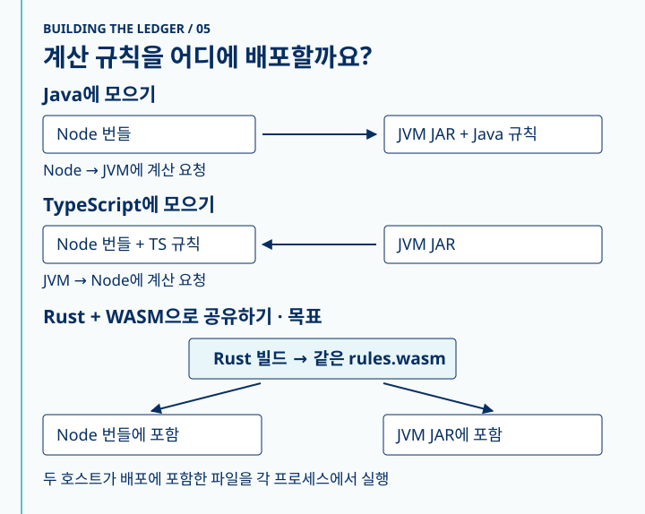
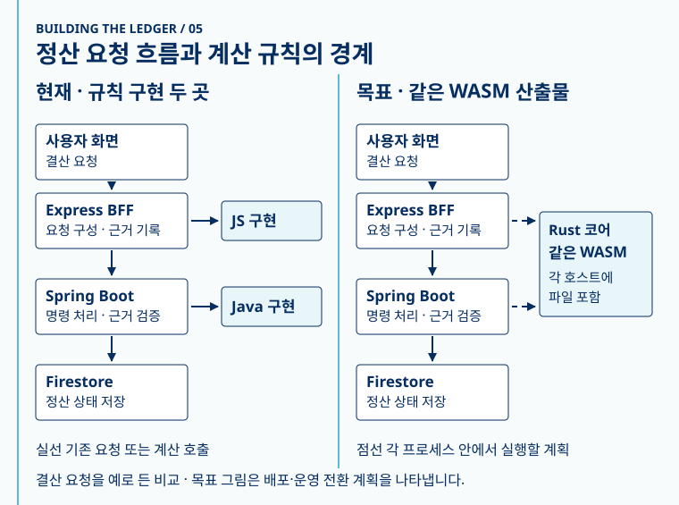

**서버는 둘인데, 같은 계산도 두 번 구현해야 할까요?**

MYSCube에서는 Node와 JVM이 같은 입력을 받아 같은 답을 내야 할 때가 있습니다. 계산식 하나를 바꿀 때마다 두 구현을 찾아 고치고, 서로 다른 배포에서 답이 어긋나지 않는지 확인해야 했어요.

한쪽 서버에 규칙을 모으고 다른 쪽에서 호출하는 방법부터 살펴봤습니다. Java에 두면 Node가 JVM에 계산을 요청하고, TypeScript에 두면 반대로 JVM이 Node에 요청합니다. 날짜처럼 입력을 미리 열거할 수 있다면 생성한 표를 배포하는 방법도 있습니다. 요청마다 다른 JSON을 받는 규칙까지 공유하려면 실행할 코드가 필요했습니다.



*그림 1. 규칙을 한 서버에 두고 호출하는 두 가지 방식과, 같은 WASM을 각 서버에 배포하는 방식.*

이 구조에서 서비스는 여전히 각각 배포합니다. 달라지는 건 두 배포에 **같은 버전의 계산 모듈**이 들어간다는 점입니다. 규칙을 고치면 Rust에서 WASM을 한 번 만들고, Node 번들과 JVM JAR에 같은 산출물을 포함합니다. 대신 호스트마다 입력을 넘기고 결과를 읽는 코드가 필요하고, WASM과 호스트가 같은 ABI 버전을 쓰는지도 확인해야 합니다.

Rust를 택한 이유는 MYSCube에 이미 계산을 독립적으로 테스트할 수 있는 Rust 코어가 있었기 때문입니다. 규칙을 그 코어에 추가하면 같은 소스를 Rust 테스트로 실행한 뒤 WASM으로 빌드해 호스트 호출까지 확인할 수 있었습니다. 이번에 코드로 확인한 범위는 JVM 내부의 중복 제거, Rust 함수 추출, Node에서의 WASM 시범 호출입니다. 두 배포에 같은 WASM을 넣고 운영 경로를 전환하는 일은 다음 단계입니다.

## 서버를 나눈 뒤, 같은 계산이 여러 곳에 남았습니다

이 시리즈의 앞선 글에서 소개한 Express와 Spring Boot는 서로 다른 책임을 맡습니다. Express는 시트와 화면 사이에서 데이터의 형태를 맞춥니다. Spring Boot는 현재 저장된 상태를 읽고, 요청한 명령을 처리할 수 있는지 확인한 뒤 트랜잭션을 완료합니다.

그런데 화면에서 어떤 기록을 보여줄지 결정하는 코드와, 서버에서 어떤 기록을 처리할지 결정하는 코드가 같은 계산을 필요로 할 때가 있습니다. 이때 호출부마다 계산식을 두면 수정의 범위가 서비스 경계를 넘어갑니다. 같은 런타임에서도 이 문제가 생겼습니다. JVM의 요약 계산기, 정산 이력 조회, 제출 기한 관련 코드가 날짜의 구간을 각자 구하고 있었어요.

먼저 같은 역할을 하는 JVM 코드를 한곳으로 모았습니다. 아래는 요약 계산기에서 날짜를 주차로 바꾸던 부분을 줄여 옮긴 코드입니다.

```java
// 변경 전: 호출부가 날짜 구간을 직접 계산
int mondayOffset = month.atDay(1).getDayOfWeek().getValue() - 1;
int rawWeek = (mondayOffset + date.getDayOfMonth() - 1) / 7 + 1;
return new FinanceWeek(month.toString(), Math.min(rawWeek, 5));

// 변경 후: 시간대 변환과 반환 타입은 호출부에 둡니다.
CashflowFinanceWeek week = CashflowFinanceWeek.containing(
    LocalDate.now(clock.withZone(BUSINESS_ZONE))
);
return new FinanceWeek(week.yearMonthText(), week.weekNo());
```

`containing(LocalDate)`는 기존 `CashflowWeekDeadline.weekRange`가 반환하는 구간에서 답을 찾습니다. 다른 JVM 호출부도 이 경로를 사용하게 바꿨습니다. 호출부가 가진 시간대, 반환 타입, 범위 검사는 각 경로의 계약대로 유지합니다. 이 단계의 코드는 Java에서 실행됩니다. 덕분에 공용 WASM을 붙이기 전에도 JVM 안에서 수정할 계산식은 줄었습니다.

## Rust로 옮긴 코드와 기존 서버에 남긴 코드

MYSCube에는 이미 시트의 계산 규칙을 검증하는 Rust 코어가 있었습니다. 여기에는 날짜나 값처럼 필요한 입력을 모두 받은 뒤, 저장소 없이 결과를 계산할 수 있는 함수를 추가할 수 있었습니다. 같은 Rust 함수를 네이티브 테스트에서 실행하고 WASM으로도 빌드할 수 있다는 점이 이 작업에 맞았습니다.

| 경계 | 기존 구조 | 이번에 바꾼 구조 |
| --- | --- | --- |
| 명령 처리 | Spring Boot가 현재 상태와 요청을 확인한 뒤 저장 | 기존 서비스가 계속 처리 |
| JVM 안의 반복 계산 | 여러 호출부가 날짜 구간을 직접 계산 | 공통 Java 함수 호출 |
| Node 쪽 이관 코드 | 이관 스크립트에 별도의 날짜 계산식 | 기존 TypeScript 공통 함수 호출 |
| 여러 런타임에서 필요한 규칙 | TypeScript와 Java 구현을 따로 검증 | Rust 함수와 공유 대조표를 추가하고, 한 규칙에서 Node의 WASM 호출을 시범 검증 |

트랜잭션 안에서 어떤 문서를 읽고 갱신할지는 호스트의 일입니다. 코어는 호스트가 넘긴 입력을 계산하고 결과를 돌려줍니다. 그래서 Rust 모듈이 들어온 뒤에도 Express와 Spring Boot의 요청 처리 흐름은 그대로 읽을 수 있습니다. 공용 WASM으로 연결할 때 바뀌는 부분은 그 흐름 안에서 규칙을 호출하는 지점입니다.



*그림 2. 주·월결산 루프와 JVM→Rust 회로도를 바탕으로 비교한 정산 백엔드 구조. 요청과 저장 흐름은 양쪽에 그대로 보이고, 계산 규칙을 호출하는 부분이 달라집니다.*

## 같은 Rust 함수를 두 런타임에서 호출하는 방법

공유하는 방법도 몇 가지 살펴봤습니다. **날짜만 받는 규칙**이라면 Rust로 주차표를 생성해서 JVM이 읽게 할 수 있어요. 재무 담당자가 바뀐 날짜를 표에서 바로 확인할 수 있고 Java 런타임 의존성도 생기지 않습니다. 대신 표의 지원 범위를 관리해야 하고, 입력 구조가 다양한 결산 JSON이나 수식 검사에는 같은 방법을 쓰기 어렵습니다.

별도 서비스로 빼면 Node와 JVM이 같은 HTTP API를 호출할 수 있습니다. 다만 승인 트랜잭션 안에서 규칙을 실행할 때 네트워크 왕복이 늘고, 배포하고 장애를 살펴야 할 서비스도 하나 더 생깁니다. 네이티브 라이브러리는 네트워크 없이 호출할 수 있지만 운영체제와 아키텍처별 바이너리, JVM의 네이티브 경계를 함께 관리해야 해요.

현재 설계는 **같은 WASM 파일을 두 호스트에서 실행하는 것**입니다. 공유 소스를 각 언어로 다시 구현하는 대신 산출물 자체를 공유하면, 정렬과 숫자 표기를 고치는 곳이 하나가 됩니다. Node는 내장 WebAssembly를 쓰고 JVM 쪽은 순수 Java 런타임인 Chicory를 후보로 두고 있어요. 재무 주차 시범에서는 연·월·일을 정수로 넘기고, WASM 메모리의 11개 정수에서 결과를 읽습니다. 날짜 계산 코드는 Rust 코어에 있고, WASM 쪽은 호출을 받고 결과를 전달합니다. 결산 JSON처럼 구조가 있는 입력을 받는 공용 인터페이스와 JVM 패키징은 이후 단계입니다.

시범 로더에서 테스트한 건 Rust 함수의 결과만이 아니었습니다. 호스트는 모듈을 로드한 뒤 ABI 버전을 검사하고, 함수가 성공을 반환했을 때만 결과 메모리를 읽습니다. 아래는 날짜 규칙에 사용한 Node 로더의 일부를 단순화한 코드입니다.

```js
if (exports.abi_version() !== 1) {
  throw new Error("Unsupported WASM ABI");
}
const outOffset = exports.out_ptr();
const ok = exports.finance_week_for_date(year, month, day);
if (ok !== 1) return undefined;
const result = new Int32Array(exports.memory.buffer, outOffset, 11);
```

결과를 읽을 때마다 현재 `memory.buffer`로 뷰를 다시 만듭니다. WASM 메모리가 늘어나면 이전 버퍼를 계속 쓸 수 없기 때문이에요. 이 시범의 입출력은 고정 크기 정수로 끝납니다. 가변 길이 JSON은 호스트와 모듈이 UTF-8 바이트의 포인터와 길이를 주고받고, 언제 메모리를 해제할지 정하는 별도 계약이 필요합니다. 계획에는 그 경계를 두되, 현재 주차 로더가 결산 해시까지 실행한다고 보지 않습니다.

배포 쪽에도 조건이 있습니다. 두 호스트가 서로 다른 시점에 각자 빌드한 파일을 읽으면 어떤 규칙 버전이 실행됐는지 추적하기 어렵습니다. 그래서 계획에는 툴체인을 고정하고 CI에서 산출물의 바이트를 확인한 뒤, 같은 파일을 Node 번들과 JVM 리소스에 넣는 단계가 들어 있습니다.

## 포팅한 코드가 같은 답을 낸다는 걸 어떻게 확인했나요?

테스트를 만들 때도 구현을 복제하면 같은 실수를 반복할 수 있어요. 재무 주차 시범의 초기 Rust 테스트에는 Java 계산식을 Rust로 옮겨 적은 코드가 있었습니다. 이 테스트가 통과해도 Java에서 날짜를 변환하거나 지원 범위를 검사하는 경로까지 검증되지는 않습니다.

후속 변경에서는 현재 TypeScript 구현으로 기대값을 생성하고, 같은 파일을 TypeScript·Java·Rust 테스트가 읽게 했습니다. Java 테스트는 실제 프로덕션 함수를 호출합니다. 공통 함수로 정리하면서 기존 날짜 범위 검사가 빠졌을 때는 기존 Java 경계 테스트가 그 차이를 잡아냈어요. WASM 테스트는 별도로 Node에서 빌드 산출물을 호출해, 정수를 넘기고 선형 메모리에서 결과를 읽는 부분까지 TypeScript와 비교했습니다.

결산 근거 해시에도 같은 방식을 적용하되, 기대값은 BFF가 기록해 온 정규화 문자열입니다. 여기까지 main에 들어간 것은 BFF와 Rust의 공유 대조표입니다. 결산 해시의 Java 대조는 후속 단계에 들어갑니다.

## 두 번째 규칙을 옮기며, 비교할 바이트를 고정했습니다

재무 주차 시범에서는 날짜와 결과를 바로 대조할 수 있었습니다. 결산 근거에서는 BFF가 해시를 기록하고 JVM이 확정 직전에 다시 계산합니다. 두 곳이 모두 SHA-256을 써도 입력 바이트가 다르면 결과는 갈립니다. 그래서 대조 단위를 해시 함수에 들어가기 직전의 JSON 문자열로 잡았습니다.

공유 대조표를 만들 때 실제 BFF와 Java 구현을 돌려 보니 다섯 가지 입력에서 이미 결과가 갈렸습니다. 아래는 그중 키 정렬을 보여주는 테스트용 예시입니다.

```text
입력       {"10":"ten","9":"nine","01":"leading zero","a":"text"}
BFF        {"9":"nine","10":"ten","01":"leading zero","a":"text"}
기존 JVM   {"01":"leading zero","10":"ten","9":"nine","a":"text"}
```

자바스크립트는 객체를 JSON으로 내보낼 때 배열 인덱스처럼 생긴 키를 숫자 순서로 앞에 배치합니다. 그래서 `"9"`가 `"10"`보다 먼저 나와요. 앞에 0이 붙은 `"01"`은 이 규칙의 적용을 받지 않습니다. 다른 네 경우는 제어문자를 이스케이프할 때 쓰는 16진수 대소문자, 아주 작은 수의 지수 표기, 큰 수의 표기, 자바스크립트가 정확히 표현할 수 있는 정수 범위를 넘는 값에서 나왔습니다. 이 입력들은 차이를 재현하기 위해 만든 테스트 데이터입니다. 이 다섯 경우가 실제 결산을 막았다는 운영 기록은 확인하지 못했습니다.

여기서 의외였던 점은 기존 BFF 코드에 이미 키 정렬이 있다는 거예요. 아래는 객체를 처리하는 부분을 줄인 코드입니다.

```js
const sorted = Object.fromEntries(
  Object.keys(value).sort().map((key) => [key, stableSort(value[key])]),
);
return JSON.stringify(sorted);
```

`sort()`만 보면 `"10"`이 `"9"`보다 먼저 올 것 같습니다. 그런데 정렬된 항목으로 **객체를 다시 만든 다음** 직렬화해요. 그 과정에서 배열 인덱스 키는 열거 순서가 달라집니다. Rust에서는 인덱스 키인지 먼저 판별해 숫자 순으로 내보내고, 나머지는 UTF-16 코드 유닛 순서로 비교합니다. 중첩 객체에는 이 규칙을 반복 적용하고, 배열은 입력 순서를 보존합니다. 서로 다른 런타임에서 결과를 맞추려면 정렬 코드뿐 아니라 최종 직렬화까지 봐야 했어요.

숫자에서는 출력 형식만 맞춰서는 부족했어요. 예를 들어 JSON의 긴 소수를 읽을 때 파서가 서로 인접한 두 부동소수점 값 중 다른 쪽을 고르면, 출력 형식이 같아도 마지막 자릿수가 달라질 수 있습니다. PR에서 무작위 숫자 20만 개를 비교하는 과정에 `serde_json` 기본 설정이 일부 17자리 소수를 한 ULP, 즉 그 지점에서 표현할 수 있는 인접 값 한 칸만큼 다르게 읽는 경우가 나왔습니다. 그래서 코어에서 `float_roundtrip` 옵션을 켰고, 출력 쪽도 자바스크립트의 숫자 표기를 따르도록 맞췄습니다. 정산 커널의 기존 TypeScript 대조도 다시 실행했습니다.

예를 들어 테스트에 넣은 `1e-7`은 두 구현에서 숫자 값이 같아도 기존 Java 쪽은 `1E-7`, BFF는 `1e-7`을 내보냈습니다. 이 경우는 파싱 이후의 출력 차이입니다. 반면 한 ULP 차이는 문자열을 읽는 순간 값이 달라진 경우예요. 그래서 파서 설정을 고정하는 일과 출력 포맷을 맞추는 일을 따로 검증했습니다. 여기서 부동소수점을 쓰는 이유는 기존 JavaScript 직렬화와의 호환입니다. 장부의 금액 계산 방식을 바꾸는 작업과는 별도로 다뤘습니다.

코어와 호스트의 경계를 코드로 보면 다음과 같습니다. 호출을 설명하기 위해 단순화한 예시입니다.

```text
JSON 입력 → Rust canonical_close_json → 정규화된 JSON 문자열
          → 호스트의 SHA-256 → 근거 해시
```

호스트는 저장과 비교를 계속 맡습니다. 코어에 전달하는 계약은 JSON을 어떤 바이트로 표현할지까지입니다.

기준은 결산 요청에 해시를 먼저 써 온 BFF입니다. 일반 사례 10건과 기존 JVM이 다른 값을 낸 5건을 표에 넣었어요. Rust는 SHA-256에 들어갈 JSON 문자열까지 책임집니다. 해시 계산은 각 호스트의 표준 구현을 사용하도록 경계를 뒀습니다. BFF 테스트는 문자열과 최종 해시를 모두 비교해요.

그리고 테스트가 정말 차이를 잡는지도 확인했습니다. 대조표 복사본에서 키 순서 사례의 기대 문자열 한 줄을 일부러 틀리게 만든 뒤 Rust 테스트를 돌렸더니, 그 사례가 실패하면서 기대한 문자열과 실제 문자열이 함께 나왔어요. 원래 값을 돌려놓으면 다시 통과합니다. 해시 두 개를 보고 원인을 추측하는 대신, 승인 전에 달라지는 바이트가 어디에서 생겼는지 확인할 수 있습니다.

## 구현을 병합한 뒤에도 전환이 남습니다

재무 주차 시범 코드와 WASM 로더, 세 언어가 읽는 대조표, 결산 해시의 Rust 정규화 함수가 main에 들어갔습니다. Rust 코어와 기존 TypeScript 정산 커널의 대조는 CI에서 실행됩니다. 별도 WASM 주차 테스트는 로컬에서 빌드해 직접 실행했습니다. 지금 운영의 주차 판정과 월결산 확정 경로에는 기존 구현이 쓰입니다.

테스트가 통과해도 실제 호출 입력의 분포까지 알 수는 없습니다. 예를 들어 대조표에 없는 입력에서 문자열이 갈리면 섀도 단계에서는 그 차이를 관측하되, 승인 결과에는 기존 구현의 값이 반영됩니다. 계획은 차이를 규칙 이름과 빌드 식별자로 추적하고, 근거 JSON이나 금액 원문은 로그에 남기지 않는 방식입니다. 불일치가 확인되면 실제 데이터를 그대로 옮기는 대신 같은 차이를 만드는 최소 입력을 만들어 회귀 테스트에 넣습니다.

전환과 삭제도 별도 변경입니다. 전환 직후에는 문제가 생겼을 때 기존 구현을 쓰는 모드로 돌아갈 수 있어야 합니다. 관찰을 마친 뒤 기존 구현을 제거하면 그때부터는 두 구현을 함께 관리할 이유가 사라집니다.

다음 단계에서는 같은 입력을 기존 구현과 Rust 양쪽에 넣고, 업무에는 기존 결과를 씁니다. 최소 14일을 관찰하고 해당 규칙이 실제로 쓰이는 주기를 한 번 이상 지나야 합니다. 월결산이라면 결산 기한을 포함해서 봐야 의미가 있어요. 차이가 나오면 어느 결과가 맞는지 정해 대조표에 추가하고 관찰 기간을 다시 셉니다. 전환 뒤에는 한 릴리스 안에 옛 계산을 지우는 단계까지 계획에 들어 있습니다.

이 리팩토링의 끝은 Rust 함수가 추가되는 커밋이 아닙니다. 다음에 결산 근거 규칙을 바꿀 때 구현 한 곳과 대조표를 함께 수정하고, BFF와 JVM이 그 결과를 쓰게 되는 시점입니다. 그래서 진행 상황도 Rust 코드가 얼마나 늘었는지보다, 같은 규칙을 직접 계산하는 사본이 얼마나 남았는지로 보고 있습니다.
